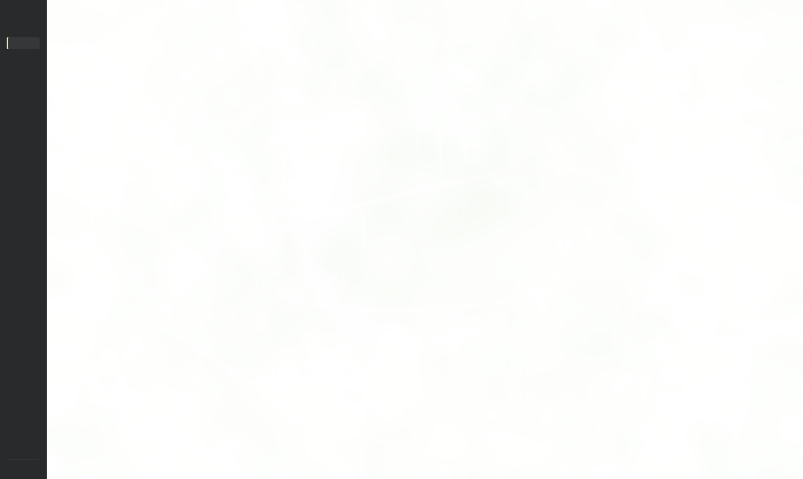

# NEXUS — Interactive 3D Digital Universe

NEXUS is an immersive, real-time WebGL experience built around a single, fully procedural
centrepiece — the **Nexus Core** — with custom GLSL shaders, a CPU particle simulation, a
GPU-driven WebGPU compute experiment, live material and shader laboratories, and a monitor
that reports only *measured* statistics.

No 3D model assets are used anywhere. Every vertex, texture and colour in the scene is
generated from mathematics at runtime.



---

## Quick start

```bash
npm install
npm run dev        # development server
npm run build      # typecheck (tsc -b) + production build
npm run preview    # serve the production build
npm run smoke      # headless-browser QA suite (see "QA harness" below)
```

Requires Node 18+ and a browser with **WebGL 2**.

## What's in the experience

| Section | What it does |
|---|---|
| **01 · Universe** | Full-screen immersive view of the Nexus Core: orbit, zoom, pointer-interactive surface, press-and-hold repels the particle halo, click any part to identify its layer. |
| **02 · Object Explorer** | Inspect every layer of the object (core / rings / lattice / halo): what geometry it is built from, how it is constructed, and toggle its visibility. Camera presets ease to curated views. |
| **03 · Shader Lab** | Live controls mapped 1:1 to the core shader's uniforms — displacement amplitude, noise frequency, Fresnel exponent, cosine-palette phase, pointer influence, time scale. |
| **04 · Particle Lab** | Real-time particle simulation parameters (cohesion, pointer attraction, turbulence, sprite size, trail opacity, active count) plus the isolated **WebGPU compute experiment**: 65,536 particles integrated entirely in a WGSL compute pass. |
| **05 · Material Studio** | Physically based parameters of the orbital ring material: colour, metalness, roughness, transmission, opacity, emissive intensity, light intensity. |
| **06 · Performance Monitor** | Measured-only stats sampled from the running renderer: FPS, frame-time EMA, draw calls, triangles, live particles, geometries, textures, programs, pixel ratio, adaptive scale, JS heap, GPU renderer string (each field annotated with its source). |
| **07 · Settings** | Quality (pixel-ratio caps), post-processing, shadow mapping, antialiasing, simulation on/off, reduced-motion honouring, performance mode. |

Keyboard: `1–7` switch sections, `Space` toggles motion, `Esc` closes the panel.
The whole UI is keyboard-navigable and screen-reader labelled.

## The centrepiece (all procedural)

- **Core** — a 64-subdivision icosphere (~41k triangles) displaced in a custom vertex shader by
  two octaves of 3D simplex noise plus a pointer-tracking bulge, shaded by a double
  domain-warped fbm cosine palette with a Fresnel rim (custom `ShaderMaterial`).
- **Orbital rings** — three mutually inclined tori sharing one `MeshPhysicalMaterial`
  (the object that Material Studio drives live), with transmission support.
- **Micro-lattice** — 1,152 radially-oriented rods on a two-shell Fibonacci sphere
  distribution, rendered as a **single instanced draw call**.
- **Particle halo** — up to 24,000 particles integrated on the CPU (home-shell springs,
  inverse-square pointer attractor/repulsor, divergence-limited swirl field, exponential
  damping, hard-shell containment) with **zero per-frame allocations**, rendered as
  instanced billboards plus 3,000 velocity-stretched trail segments.
- **Shadow catcher** — a `ShadowMaterial` plane grounding the composition under the key light.

## Rendering engineering

- Three.js r187, `WebGLRenderer`, `EffectComposer` → `UnrealBloomPass` → `OutputPass`,
  ACES tone mapping, PCF shadow mapping, PMREM environment from a procedural `RoomEnvironment`.
- Adaptive resolution: a frame-time EMA drives a 60–100 % pixel-ratio scale with cooldowns,
  bounded by per-quality DPR caps; performance mode pins the ratio and choreography.
- Full lifecycle handling: context loss/restoration, visibility-based loop suspension,
  `ResizeObserver`, clamped `devicePixelRatio`, explicit disposal of every geometry,
  material, render target, PMREM environment and controls instance.
- Counted frame instrumentation: `renderer.info.autoReset` is disabled and the counter is
  reset once per frame so draw calls and triangles include **all** passes (shadow, scene,
  bloom chain), not just the last one.

## QA harness

`qa/smoke.mjs` runs the production build in headless Chromium (SwiftShader WebGL) and
asserts:

- zero `console.error` / `pageerror` events during the full session,
- the loading veil retires, the canvas is live and the composited screenshot contains lit,
  chromatically varied pixels (real renderability, not a black frame),
- all seven panels open via keyboard, sliders exist and dispatch live uniform changes,
- layer visibility switches flip real state,
- the monitor reports measured numeric cells (FPS, draw calls, triangles, ...),
- `Space` toggles the simulation,
- WebGPU availability is honestly probed and reported (the headless shell reports no
  adapter; the UI shows the graceful fallback message).

Run it with `npm run build && npm run smoke` (assumes Playwright Chromium is installed).
In the sandboxed CI environment this suite required patched shared libraries — the measured
figures in this README come from that environment (software rasterization) and are therefore
*worst-case* references, not the experience on real hardware.

## Performance notes

Measured in the QA environment (Chromium headless shell, **SwiftShader software rasterization** —
deliberately hostile conditions):

- ~10 FPS software-rendered at 1440×860 with bloom on; the same frame is comfortably
  real-time on any discrete/integrated GPU from the last decade.
- 25 draw calls and ~175k triangles per frame at 12,000 particles — post chain included.
- The engine never allocates in the render loop (reused vectors/matrices; preallocated
  typed arrays with prefix-based counts for the particle field).

See `docs/KNOWN-LIMITATIONS.md` for honest boundaries of the current implementation.

## Browser compatibility

- **WebGL 2 required.** Detected up front; unsupported browsers get an explanatory panel
  instead of a broken canvas.
- Chrome / Edge 113+: full experience, GPU renderer string via `WEBGL_debug_renderer_info`.
- Firefox / Safari (16.4+): full WebGL experience. `JS heap` is Chromium-only and reports as
  unavailable elsewhere — surfaced as such, never guessed.
- **WebGPU** (Chrome/Edge 113+, recent Firefox Nightly): the compute experiment lights up
  automatically; `Particle Lab` shows exactly what is supported and why otherwise.

## Repository layout

```
src/
  engine/     NexusEngine.ts      renderer, scene assembly, lifecycle, adaptive quality
  scene/      nexusObject.ts      procedural centrepiece
              particleField.ts    CPU simulation + instanced billboard/trail buffers
  shaders/    core.ts             core vertex/fragment (simplex, double domain warp, palette)
              particles.ts        halo billboard + trail shaders
  webgpu/     computeDemo.ts      modular WGSL compute experiment + capability probe
  state/      store.ts, perf.ts   Zustand stores (settings + throttled measured stats)
  ui/         NavRail, CanvasStage, controls, ErrorBoundary
  panels/     Explorer-, ShaderLab-, ParticleLab-, MaterialStudio-, Monitor-, SettingsPanel
  styles/     global.css          design system (graphite editorial, one accent)
qa/           smoke.mjs           headless functional/renderability suite
docs/         ARCHITECTURE.md, KNOWN-LIMITATIONS.md
```

## Technical decisions

See [`docs/ARCHITECTURE.md`](docs/ARCHITECTURE.md) for the full reasoning — including why
the halo uses instanced quads instead of `gl_Points` (a real portability bug this project
found and fixed), why the engine is imperative rather than R3F, and how state flows between
React and the render loop.
