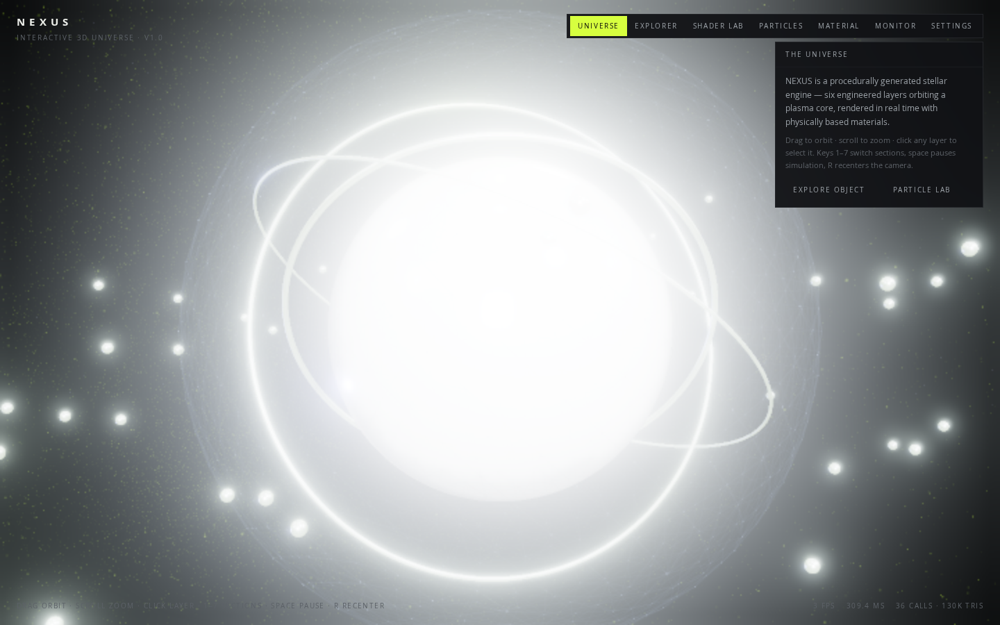
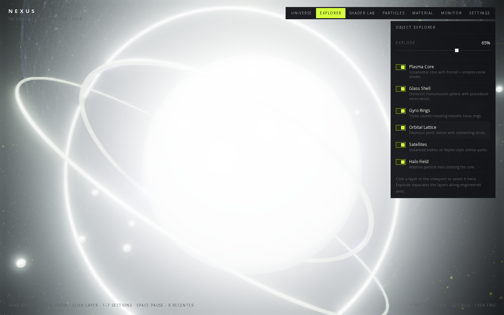
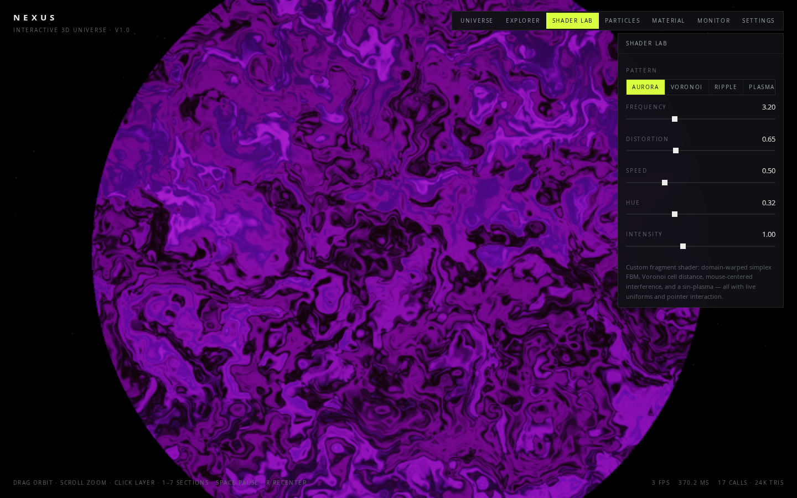
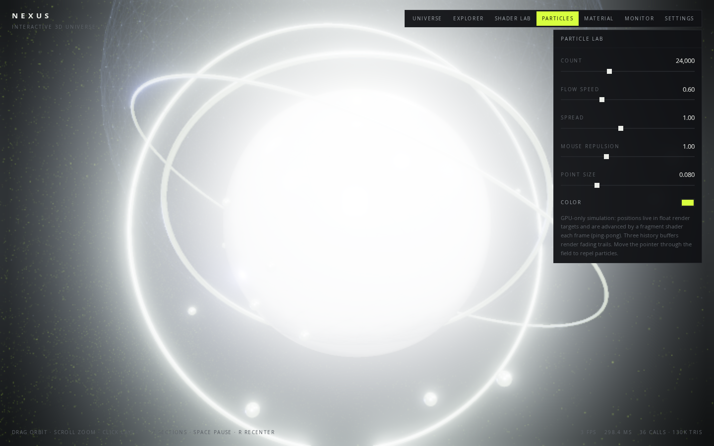
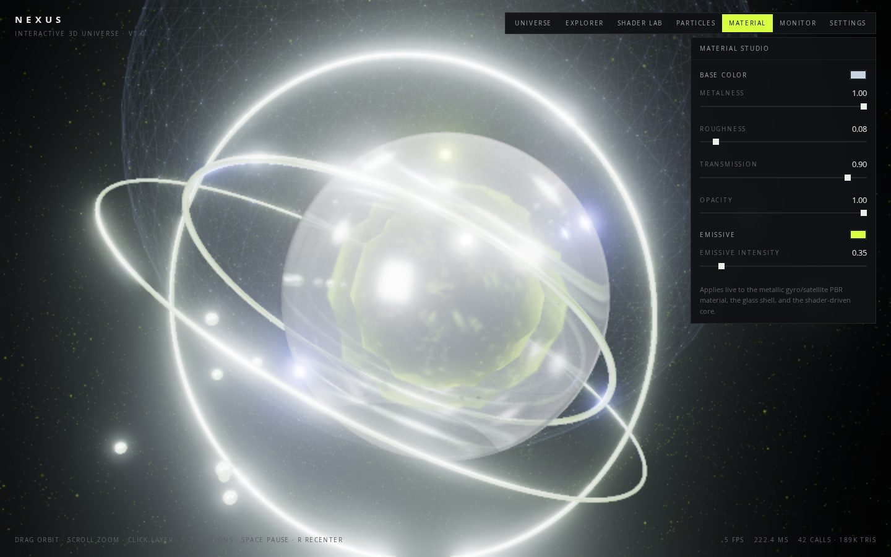
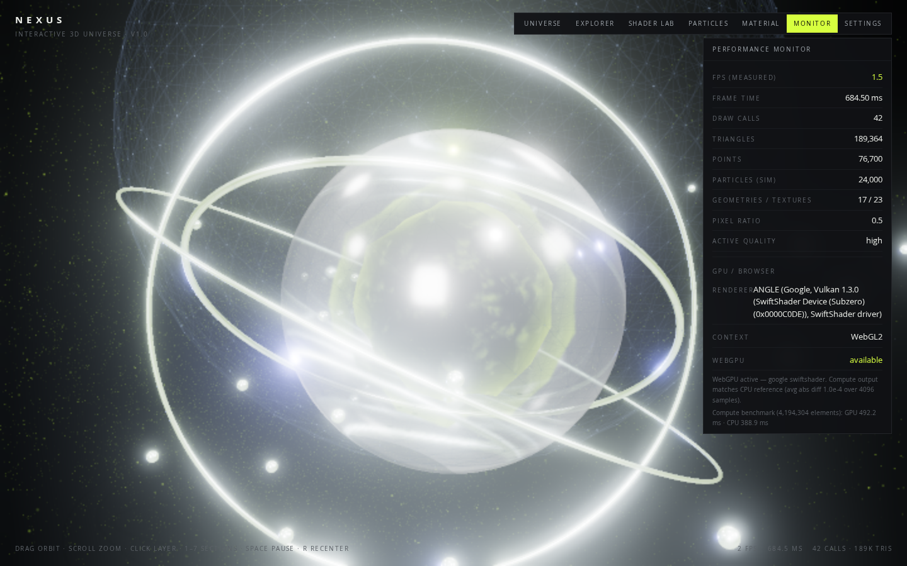
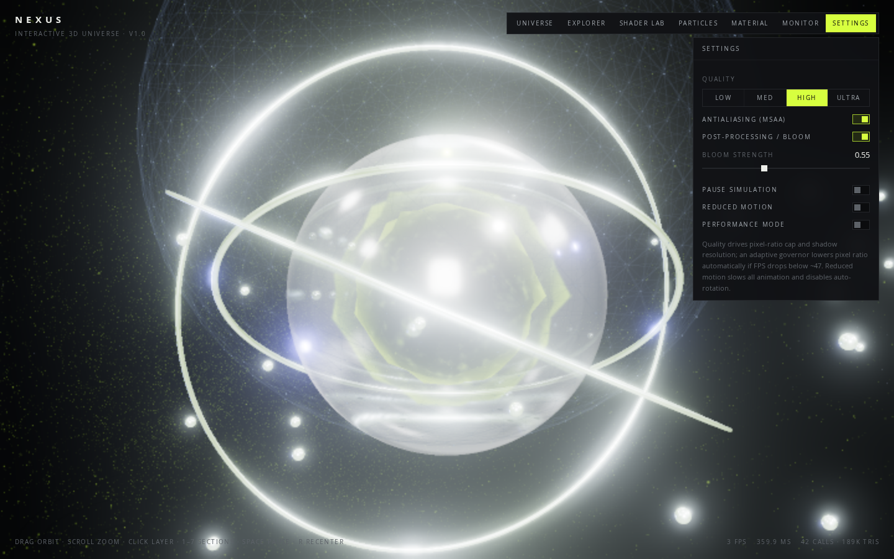

# NEXUS — Interactive 3D Universe

## Live preview

Deployed automatically to GitHub Pages on every push to `main`: **https://mdhossain-2437.github.io/nexus-test/**

## Preview (captured from a real headless-Chromium run against `npm run dev`)

| Universe | Object Explorer (exploded) |
| --- | --- |
|  |  |

| Shader Lab | Particle Lab |
| --- | --- |
|  |  |

| Material Studio | Performance Monitor | Settings |
| --- | --- | --- |
|  |  |  |


NEXUS is an immersive, real-time 3D digital universe built as a single-page application: a procedurally engineered
stellar engine as the centerpiece, a GLSL shader laboratory, a GPU-driven particle simulation, a live material
studio, a WebGPU experiment, and a measured performance monitor — wrapped in a dark, editorial interface.

Everything on screen is rendered in WebGL2 at runtime. No premade models, no static images, no faked metrics.

## Quick start

```bash
npm install
npm run dev        # http://localhost:5173
npm run build      # typecheck + production build into dist/
npm run preview    # serve the production build
```

Requires Node 20+. No other tooling.

## What's inside

| Section | What it does |
| --- | --- |
| **Universe** | Full-screen real-time scene: procedural NEXUS object (6 layers), PBR materials, environment reflections, shadow mapping, bloom post-processing, orbit/zoom/click interaction. |
| **Object Explorer** | Explode the centerpiece along engineered axes; toggle and select individual layers (core, shell, gyro rings, lattice, satellites, halo). Clicking a layer in the viewport selects it. |
| **Shader Lab** | Live custom fragment shader on a sphere: 4 procedural patterns (domain-warped FBM aurora, Voronoi, mouse-centered ripple, sin-plasma) with frequency, distortion, speed, hue, intensity controls. |
| **Particle Lab** | Up to 65,536 particles simulated entirely on the GPU (ping-pong float render targets, fragment-shader flow field + mouse repulsion), with 3 history buffers rendered as fading trails. Adjustable count, speed, spread, repulsion, size, color. |
| **Material Studio** | Live metalness / roughness / transmission / opacity / color / emissive / emissive-intensity on the PBR materials and shader core. |
| **Performance Monitor** | Measured FPS, frame time, draw calls, triangles, points, geometry/texture counts, particle count, pixel ratio, GPU renderer string, WebGL version, and the WebGPU experiment result. Unavailable values are shown as "—", never estimated. |
| **Settings** | Quality presets (pixel-ratio cap + shadow resolution), MSAA toggle, post-processing toggle, bloom strength, pause, reduced-motion, performance mode. |

Keyboard: `1–7` switch sections · `space` pause · `R` recenter camera · `Esc` deselect layer.
Pointer: drag to orbit, scroll to zoom, move to repel particles, click a layer to select it.

## Stack

- **Vite 8 + React 19 + TypeScript (strict)** — build and UI
- **Three.js r187** — WebGL2 renderer, PBR, PMREM environment, shadow maps, post-processing (`EffectComposer` + `UnrealBloomPass` + `OutputPass`), `OrbitControls`
- **Custom GLSL** — simplex noise/FBM, fresnel, domain warping, GPGPU particle sim, 4 lab patterns (`src/lib/shaders/glsl.ts`)
- **Zustand** — UI/render state (`src/store.ts`)
- **Tailwind CSS v4** — design tokens and component styling (`src/styles/global.css`)
- **WebGPU** — optional compute experiment with automatic WebGL2 fallback (`src/lib/webgpu.ts`)

React Three Fiber was deliberately **not** used: the scene needs direct control over the renderer, GPGPU render
targets, the composer and context-loss handling, which R3F's reconciler would fight. Plain three.js inside a
React-managed lifecycle gives the same component boundaries with less overhead. See `docs/ARCHITECTURE.md`.

## Browser compatibility

- **Required:** WebGL2 (Chrome/Edge 80+, Firefox 78+, Safari 15+). WebGL1-only browsers get a clear error message.
- **Optional:** WebGPU (Chrome/Edge 113+ on supported hardware). If unavailable, the app reports it honestly and
  continues on WebGL2 — it never claims WebGPU is running when it is not.
- GPU particle sim requires float render targets (`EXT_color_buffer_float`); without it the sim falls back to
  half-float targets automatically.
- Mobile: the canvas is touch-enabled; panels collapse to viewport width; `prefers-reduced-motion` is honored.

## Performance

- Single renderer, single scene, one composer — draw calls stay low (~10–20) because layers are few and satellites
  use `InstancedMesh`.
- Particles are GPU-simulated: zero per-frame CPU buffer uploads, zero per-frame allocations; count changes use
  `setDrawRange`, not reallocation.
- Adaptive pixel ratio: an automatic governor steps the pixel ratio down if measured FPS stays below ~47, and back
  up when above ~57 (disabled in performance mode, which pins a low ratio).
- Quality presets cap pixel ratio and shadow-map size; MSAA toggles rebuild the renderer cleanly.
- Context loss/restoration, tab visibility, resize (ResizeObserver) and full disposal on unmount are handled —
  no GPU resource leaks on teardown.

### How to test performance yourself

1. `npm run dev`, open **Monitor** (`6`): watch measured FPS / frame time / draw calls / triangles.
2. Push **Particle Lab** count to 65,536 and watch FPS; then switch **Settings** quality to Low and performance
   mode on — the adaptive governor and presets should recover interactivity.
3. Open DevTools → Performance and record while orbiting: frame time should stay near your display refresh on a
   modern desktop GPU.

## Project structure

```
src/
  main.tsx                  entry
  App.tsx                   layout shell, keyboard, lifecycle
  store.ts                  zustand state (view, params, settings, perf, webgpu)
  types.ts                  strict shared types
  styles/global.css         design tokens + component styles (Tailwind v4)
  lib/
    SceneManager.ts         renderer/scene/camera/lights/composer/loop/lifecycle
    NexusObject.ts          procedural centerpiece (6 layers, explode, raycast)
    Particles.ts            GPGPU particle field (ping-pong float targets + trails)
    ShaderLab.ts            shader-lab surface
    webgpu.ts               WebGPU detection + compute benchmark + fallback
    capabilities.ts         WebGL/WebGPU capability detection
    shaders/glsl.ts         all GLSL (noise, core, halo, sim, particles, lab)
  components/
    Nav.tsx, panels.tsx, ui/controls.tsx, ui/ErrorBoundary.tsx
docs/ARCHITECTURE.md        architecture and technical decisions
```

## Known limitations

- WebGPU section is a compute benchmark + capability report, not a full WebGPU renderer; when WebGPU is absent the
  app states that explicitly (visible in the Monitor panel).
- Shadow maps come from a single key light; the glass shell casts a solid shadow (three.js does not do
  per-ray transmitted shadows).
- The particle trail effect uses 3 history buffers (GPU memory ~3 MB at max size) — a deliberate trade-off for
  fully GPU-side trails.
- Runtime was verified in a real (headless) Chromium 153 against `npm run dev`: WebGL2 rendering via
  SwiftShader, all seven sections rendering with zero console/page errors, hover/click raycasting selecting
  layers, measured stats (36–42 draw calls, ~130–190k triangles, 76.7k points, 24k GPU particles), adaptive
  pixel-ratio governor engaging, and the WebGPU compute experiment running on a SwiftShader adapter with
  output matching the CPU reference. FPS in that software rasterizer is 1–9 (expected — no hardware GPU in
  the sandbox); on a modern desktop GPU the same scene targets 60 FPS.
